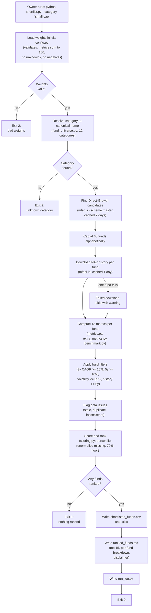

# Overview

Audience: anyone joining this project or evaluating it for the first time, to understand what it does, how its parts fit together, and what each capability covers.
Evidence: 15 of 15 entry points read · 8 capabilities · 9 open unknowns relevant to this document · commit ef2fb5a · Surveyor 2.2.0 · 2026-10-24

## What the project does and for whom

This is a local Python toolkit that helps one person (its owner) pick Indian mutual funds to invest in and decide whether to keep holding the ones they already own. It is a screening tool, not investment advice [I1, doc-diff]. Past returns are the main input; the owner makes the final call [I2, doc-diff].

The toolkit downloads daily NAV (Net Asset Value, the fund's unit price) history from mfapi.in (a free mirror of AMFI, the Association of Mutual Funds in India), computes 13 performance and risk metrics per fund, scores and ranks the funds in a category using configurable weights, and writes the results to spreadsheets and Markdown reports [S01/F001, S02/F001, S03/F001, S04/F001].

A second group of scripts screens the owner's existing holdings (from a CDSL Consolidated Account Statement, the brokerage's PDF of everything they hold) and says whether to keep each fund, watch it, or review it [S05/F005, S06/F006].

The owner runs the scripts from the command line on Windows. There is no web interface, no scheduler, no CI pipeline, and no deployment target [inventory]. The data folder and output folder are local and untracked by git [inventory, U06].

## Capabilities

| ID | Name | Importance | Entry points | Test result | Open unknowns |
|---|---|---|---|---|---|
| C01 | Shortlist and rank funds in a category | High | `shortlist.py` | Tested on the surface (end-to-end with fakes for data layer and metrics) | U10, U11, U12, U13, U14, U15 |
| C02 | Screen funds you already hold | High | `mf_holdings_screener.py`, `cdsl_holdings_to_xls.py` | F005: well tested. F006: not tested | U18, U19, U20, U21, U28 |
| C03 | Check one fund | High | `check_fund.py` | Well tested (32 checks) | U22 |
| C04 | Rank funds from a supplied metrics file | Medium | `rank_funds.py` | Well tested (22 checks) | none |
| C05 | Collect fund portfolio files and score portfolio quality | Medium | `holdings_fetch.py`, `holdings_import.py`, `build_marketcap.py`, `portfolio_quality.py` | F015: well tested. F007, F008, F010: tested on the surface | U23, U24 |
| C06 | Provide benchmark index history | Medium | `import_tri.py` | Tested on the surface (benchmark engine tested, import script not) | U25 |
| C07 | Back-test the forward signals | Medium | `backtest.py` | Unknown (cannot run: missing functions and config settings) | U26 |
| C08 | Set up, refresh data and diagnose | Low | `fetch_nav_data.py`, `live_check.py`, `apply_docx_patch.py`, `navall_diag.py` | Not tested | U27 |

C01, C02 and C03 are the capabilities the owner uses to make investment decisions. C04 through C08 support them with data, benchmarks, signal testing and diagnostics [S01-S14, capabilities.md].

## System context diagram

```mermaid
graph LR
    Owner["Owner (command line)"]
    Toolkit["Mutual Fund Toolkit\n(Python scripts)"]
    MFAPI["mfapi.in\n(NAV history API)"]
    AMFI["AMFI\n(NAVAll.txt, market-cap list)"]
    AMCSites["25 AMC websites\n(portfolio disclosure)"]
    LocalData["data/ folder\n(NAV cache, benchmarks,\nholdings, market-cap)"]
    Output["Output files\n(CSV, Excel, Markdown,\nWord, log)"]
    CDSL["CDSL CAS PDF\n(brokerage statement)"]
    TRI["NSE TRI CSV files\n(Total Return Index:\nbenchmark history)"]
    Tesseract["Tesseract OCR\n(optional, for image PDFs)"]

    Owner -->|runs scripts| Toolkit
    Toolkit -->|reads NAV history| MFAPI
    Toolkit -->|reads scheme list,\nNAVAll.txt| AMFI
    Toolkit -->|scrapes portfolio files\n(3 auto AMCs)| AMCSites
    Toolkit <-->|caches and reads| LocalData
    Toolkit -->|writes| Output
    Owner -->|supplies| CDSL
    Owner -->|supplies| TRI
    Toolkit -->|reads| CDSL
    Toolkit -->|reads| TRI
    Toolkit -.->|calls, when\nimage PDF| Tesseract
```

Every external system call is an unauthenticated HTTPS GET request. The toolkit sends no personal data externally; the scheme codes it requests from mfapi.in are public identifiers [S01, S02, S05, S06, S09, S13]. The CDSL statement and the owner's review spreadsheets contain personal financial data (folio numbers, valuations) that stay local [S05, S06, U19, U28].

Dashed line: Tesseract is called only when a CDSL PDF page has no text layer or `--force-ocr` is set [S06/F006].

## High-level architecture diagram

```mermaid
graph TD
    subgraph "Entry points (CLI scripts)"
        shortlist["shortlist.py\n(C01: rank a category)"]
        screener["mf_holdings_screener.py\n(C02: screen holdings)"]
        cdsl["cdsl_holdings_to_xls.py\n(C02: PDF to Excel)"]
        checkfund["check_fund.py\n(C03: one-fund report)"]
        rankfunds["rank_funds.py\n(C04: rank from CSV)"]
        hfetch["holdings_fetch.py\n(C05: download portfolios)"]
        himport["holdings_import.py\n(C05: sort portfolios)"]
        buildmc["build_marketcap.py\n(C05: market-cap list)"]
        importtri["import_tri.py\n(C06: benchmark import)"]
        backtest["backtest.py\n(C07: signal back-test)"]
        fetchnav["fetch_nav_data.py\n(C08: NAV download)"]
        livecheck["live_check.py\n(C08: service check)"]
    end

    subgraph "Shared libraries"
        config["config.py\n(~60 settings)"]
        funduniverse["fund_universe.py\n(scheme lookup)"]
        metrics["metrics.py\n(return, risk, rolling)"]
        extrametrics["extra_metrics.py\n(alpha, beta, capture)"]
        benchmark["benchmark.py\n(benchmark resolution)"]
        scoring["scoring.py\n(percentile scoring)"]
        weightsloader["weights_loader.py\n(weights.ini parser)"]
        datachecks["data_checks.py\n(flag stale, duplicate)"]
        fundfilters["fund_filters.py\n(AUM, tenure filters)"]
        pq["portfolio_quality.py\n(0-100 quality score)"]
        report["report.py\n(Excel export)"]
        reportmd["report_md.py\n(Markdown report)"]
        reportdocx["report_docx.py\n(Word report)"]
        amcreg["amc_registry.py\n(32 AMC definitions)"]
    end

    subgraph "Configuration"
        weightsini["weights.ini\n(metric weights)"]
        reqs["requirements.txt"]
    end

    shortlist --> funduniverse
    shortlist --> metrics
    shortlist --> extrametrics
    shortlist --> benchmark
    shortlist --> scoring
    shortlist --> datachecks
    shortlist --> fundfilters
    shortlist --> pq
    shortlist --> report
    shortlist --> reportmd
    screener --> scoring
    screener --> metrics
    screener --> benchmark
    checkfund --> screener
    checkfund --> shortlist
    checkfund --> reportdocx
    rankfunds --> scoring
    rankfunds --> datachecks
    rankfunds --> reportmd
    himport --> pq
    himport --> amcreg
    hfetch --> amcreg
    importtri --> benchmark
    weightsloader --> weightsini
    config --> weightsloader
```



All source files are at the repository root. There are no subpackages, no web framework and no database [inventory]. The library modules (lower half) are imported by the entry points (upper half). `config.py` loads `weights.ini` at import time and exposes about 60 settings as module-level constants [S01, S03].

## End-to-end flow: shortlist and rank funds in a category (C01)

This is the most important capability. It is how the owner finds new funds to invest in.



CAGR is Compound Annual Growth Rate (the annualised return over a period). The hard filters remove funds whose 3-year and 5-year returns are below 10% a year, whose price volatility exceeds 35%, or whose history is shorter than 5 years [S01/F001].

In a real run on "small cap" (2026-10-22), the pipeline found 54 candidates, excluded 17 stale funds and 23 that failed the hard filters, and ranked the remaining 14. The benchmark was auto-discovered as Motilal Oswal Nifty Smallcap 250 Index Fund (7.1 years of history). Portfolio quality scored 0 of 54 funds because no holdings files were present [S14/F001].

The same scoring engine (`scoring.py`) is reused by `mf_holdings_screener.py` (C02), `check_fund.py` (C03), and `rank_funds.py` (C04) [S05, S07, S08].

## Unknowns and next probes

These open questions affect the overview. The full list is in `docs/_evidence/open-questions.md`.

| ID | Question | Why it matters here |
|---|---|---|
| U10 | Are the hard-filter defaults the owner's intended settings? | The filters decide which funds can appear in any ranking. |
| U13 | Does the test suite pass today? Several tests expect `weights.ini` values that have changed. | A failing suite hides real faults in the scoring engine (C01, C03, C04). |
| U14 | Are the shipped weights the intended current weights? Comments say alpha and beta are off, but they have 5 points each. | The weights decide every ranking. |
| U19, U28 | Do the tracked spreadsheets contain personal financial data? | A security concern if the repository is pushed to a remote. |
| U26 | `backtest.py` cannot run (missing functions and config settings). Is this code from an unmerged branch? | Decides whether C07 is a working capability or dead code. |
| U29 | `HoldingToExcel.md` contradicts the current codebase in 10 places. Should it be removed? | Someone reading it would have a wrong picture of scoring and output. |

## Related documents

- [02-module-architecture.md](02-module-architecture.md): module layout and dependencies
- [03-request-to-response-flow.md](03-request-to-response-flow.md): per-capability flow details
- [04-shortlist-and-rank.md](04-shortlist-and-rank.md): the core capability in depth
- [09-test-exposure-map.md](09-test-exposure-map.md): test coverage per capability and flow
