# Module architecture

Audience: a developer reading the code for the first time, to understand what each file does, how they depend on each other, and where the project's own mechanisms live.
Evidence: 15 of 15 entry points read · 16 library modules read · 11 test files inventoried · 3 open unknowns · commit ef2fb5a · Surveyor 2.2.0 · 2026-10-24

## Module layout

All 57 tracked files sit at the repository root. There are no packages, no subdirectories with source code, and no `__init__.py` files [inventory]. The untracked `data/` folder holds caches and downloaded files. The untracked `out_smallcap/` folder holds one sample run's output [inventory, S14].

### Entry points (15 CLI scripts)

Each is started with `python <file>.py` and uses `argparse` for its command line [inventory].

| File | Lines | Capability | What it does |
|---|---|---|---|
| `shortlist.py` | 470 | C01 | Finds, filters, scores and ranks funds in a category. Orchestrates most library modules. [S01] |
| `rank_funds.py` | 553 | C04 | Ranks funds from a user-supplied metrics CSV, no internet. [S08] |
| `check_fund.py` | 530 | C03 | Produces a detailed report on one fund with peer comparison and screen verdict. [S07] |
| `backtest.py` | 305 | C07 | Back-tests forward signals by Spearman rank correlation on past dates. Cannot run at this commit (U26). [S12] |
| `mf_holdings_screener.py` | 977 | C02 | Screens each held fund and says keep, watch or review. Also a library (imported by `check_fund.py`). [S05] |
| `cdsl_holdings_to_xls.py` | 1,174 | C02 | Converts a CDSL brokerage PDF into two Excel files (stocks and mutual funds). Self-contained. [S06] |
| `holdings_fetch.py` | 182 | C05 | Downloads portfolio disclosure files from 3 automated AMC websites, prints a manual checklist for 29 others. [S09] |
| `holdings_import.py` | 121 | C05 | Sorts downloaded portfolio files into `data/holdings/<amc>/` and reports quality scores. [S09] |
| `build_marketcap.py` | 132 | C05 | Converts AMFI's market-cap categorisation list into `data/amfi_market_cap.csv`. [S09] |
| `import_tri.py` | 111 | C06 | Imports NSE Total Return Index CSV files as benchmark history. [S11] |
| `fetch_nav_data.py` | 116 | C08 | Downloads and caches NAV history. Also a library (imported by every script that needs NAV data). [S13] |
| `live_check.py` | 176 | C08 | First-run diagnostic: checks mfapi.in, AMFI, benchmarks, and optionally AMC downloads. [S13] |
| `apply_docx_patch.py` | 148 | C08 | One-time migration script that changed `check_fund.py` to default to Word output. [S13] |
| `navall_diag.py` | 28 | C08 | Debugging aid for AMFI NAVAll.txt parsing failures. [S13] |
| `portfolio_quality.py` | 391 | C05 | Scores portfolio quality from SEBI disclosure sheets. Also a library and a debug CLI. [S10] |

### Library modules (16 files, no entry point)

| File | Lines | What it does | Used by |
|---|---|---|---|
| `config.py` | 193 | About 60 settings as module-level constants. Loads `weights.ini` at import time via `weights_loader.apply_weights`. [S01, S03] | Every entry point and most libraries |
| `fund_universe.py` | 154 | Maps typed categories to 12 canonical names, finds Direct-Growth scheme candidates from the mfapi.in scheme master. [S01] | `shortlist.py`, `benchmark.py` |
| `metrics.py` | 346 | Computes per-fund return and risk metrics: CAGR (1, 3, 5 year), volatility, Sharpe-style and Sortino ratios, rolling returns, SIP XIRR, max drawdown. [S02] | `shortlist.py`, `mf_holdings_screener.py` |
| `extra_metrics.py` | 113 | Computes downside capture, Jensen's alpha, beta and quartile consistency. [S02] | `shortlist.py` |
| `benchmark.py` | 283 | Resolves a benchmark per category (local CSV, pinned code or auto-discovered proxy), computes excess return and rolling beat. [S02, S11] | `shortlist.py`, `mf_holdings_screener.py`, `check_fund.py`, `import_tri.py` |
| `scoring.py` | 130 | Percentile (or z-score) scoring engine: turns metric values into a 0-100 score and rank per category. [S03] | `shortlist.py`, `mf_holdings_screener.py`, `check_fund.py`, `rank_funds.py` |
| `weights_loader.py` | 94 | Parses and validates `weights.ini` (weights must sum to 100, no unknowns, no negatives). [S03] | `config.py`, `rank_funds.py`, `check_fund.py` |
| `data_checks.py` | 90 | Flags data issues: stale NAV, duplicate codes or names, category mismatch, inconsistent history length. [S03] | `shortlist.py`, `rank_funds.py`, `check_fund.py` |
| `fund_filters.py` | 96 | Merges an optional attributes CSV and applies five optional filters (AUM, tenure, turnover, cash, concentration). [S01] | `shortlist.py` |
| `portfolio_quality.py` | 391 | Parses SEBI-style AMC workbooks and computes a 0-100 quality score from five sub-criteria. [S10] | `shortlist.py`, `holdings_import.py` |
| `amc_registry.py` | 143 | Defines 32 AMCs with aliases, page URLs, download modes (auto, manual, gated, not found). [S09] | `holdings_fetch.py`, `holdings_import.py` |
| `report.py` | 94 | Exports a ranked DataFrame to an Excel workbook with formatting and colour scale. [S04] | `shortlist.py` |
| `report_md.py` | 267 | Writes the Markdown ranking report with per-fund breakdown, and provides the `RunLog` class for run logging. [S04] | `shortlist.py`, `rank_funds.py`, `check_fund.py` |
| `report_docx.py` | 142 | Converts a Markdown report to a Word document (headings, tables, bullets). [S04] | `check_fund.py` |
| `forward_signals.py` | 434 | Defines 9 forward-looking signals and a tilt-and-blend mechanism. Cannot run fully at this commit (U26). [S12] | `backtest.py` |
| `manifest.py` | 70 | Writes a JSON run manifest. No caller found (searched `manifest` across `*.py` at the repository root) [S04]. | None (U17) |
| `logutil.py` | 51 | Standard-library logging helpers. [S04] | `backtest.py`, `forward_signals.py` |

### Configuration files

| File | What it controls |
|---|---|
| `config.py` | About 60 Python constants: data paths, filter thresholds, metric windows, benchmark category map, portfolio-quality switches, output file names [S01] |
| `weights.ini` | Metric weights (15 named metrics, must sum to 100), scoring method (percentile or zscore), missing-data policy, coverage floor, minimum group size [S03] |
| `requirements.txt` | Third-party packages: pandas, numpy, requests, openpyxl, xlrd, pdfplumber, xlwt, python-docx (pytesseract commented out) [inventory] |

### Test files (11 files)

| File | Style | Assertion count | Targets |
|---|---|---|---|
| `test_pipeline.py` | `check()` | 48 | `shortlist.py` end-to-end with fakes [S01] |
| `test_scoring.py` | `check()` | 95 | `scoring.py`, `weights_loader.py` [S03] |
| `test_mf_holdings_screener.py` | `def test_` + `check()` | 6 + 55 | `mf_holdings_screener.py` [S05] |
| `test_screener_peers.py` | `check()` | 17 | Peer ranking in `mf_holdings_screener.py` [S05] |
| `test_portfolio_quality.py` | `check()` | 52 | `portfolio_quality.py`, `holdings_fetch.py`, `amc_registry.py` [S09, S10] |
| `test_check_fund.py` | `check()` | 46 | `check_fund.py` [S07] |
| `test_benchmark.py` | `check()` | 41 | `benchmark.py` [S11] |
| `test_rank_funds.py` | `check()` | 25 | `rank_funds.py` [S08] |
| `test_new_metrics.py` | `check()` | 24 | `extra_metrics.py` or `metrics.py` [S02] |
| `test_metrics_window.py` | `check()` | 18 | `metrics.py` [S02] |
| `test_forward_signals.py` | `def test_` | 18 functions | `forward_signals.py`, `backtest.py`. Cannot run (U26). [S12] |

## Dependency diagram

```mermaid
graph TD
    subgraph "Entry points"
        shortlist["shortlist.py"]
        checkfund["check_fund.py"]
        screener["mf_holdings_screener.py"]
        rankfunds["rank_funds.py"]
        cdsl["cdsl_holdings_to_xls.py"]
        hfetch["holdings_fetch.py"]
        himport["holdings_import.py"]
        buildmc["build_marketcap.py"]
        importtri["import_tri.py"]
        backtest["backtest.py"]
        fetchnav["fetch_nav_data.py"]
        livecheck["live_check.py"]
    end

    subgraph "Libraries"
        config["config.py"]
        funduniverse["fund_universe.py"]
        metrics["metrics.py"]
        extrametrics["extra_metrics.py"]
        benchmark["benchmark.py"]
        scoring["scoring.py"]
        weightsloader["weights_loader.py"]
        datachecks["data_checks.py"]
        fundfilters["fund_filters.py"]
        pq["portfolio_quality.py"]
        amcreg["amc_registry.py"]
        report["report.py"]
        reportmd["report_md.py"]
        reportdocx["report_docx.py"]
        fwdsignals["forward_signals.py"]
        manifest["manifest.py"]
        logutil["logutil.py"]
    end

    subgraph "Config"
        weightsini["weights.ini"]
    end

    %% shortlist.py dependencies
    shortlist --> config
    shortlist --> funduniverse
    shortlist --> fetchnav
    shortlist --> metrics
    shortlist --> extrametrics
    shortlist --> benchmark
    shortlist --> scoring
    shortlist --> datachecks
    shortlist --> fundfilters
    shortlist --> pq
    shortlist --> report
    shortlist --> reportmd

    %% check_fund.py dependencies
    checkfund --> config
    checkfund --> screener
    checkfund --> shortlist
    checkfund --> reportdocx
    checkfund --> weightsloader
    checkfund --> datachecks

    %% mf_holdings_screener.py dependencies
    screener --> config
    screener --> fetchnav
    screener --> metrics
    screener --> benchmark
    screener --> scoring
    screener --> funduniverse

    %% rank_funds.py dependencies
    rankfunds --> config
    rankfunds --> scoring
    rankfunds --> datachecks
    rankfunds --> weightsloader
    rankfunds --> reportmd

    %% holdings pipeline
    hfetch --> config
    hfetch --> amcreg
    himport --> config
    himport --> pq
    himport --> amcreg

    %% benchmark pipeline
    importtri --> config
    importtri --> benchmark
    benchmark --> funduniverse
    benchmark --> fetchnav

    %% backtest (cannot run)
    backtest -.-> config
    backtest -.-> benchmark
    backtest -.-> fwdsignals
    backtest -.-> logutil
    fwdsignals -.-> config
    fwdsignals -.-> logutil

    %% diagnostics
    livecheck --> config
    livecheck --> funduniverse
    livecheck --> fetchnav
    livecheck --> benchmark
    livecheck --> screener
    livecheck --> hfetch

    %% config loads weights
    config --> weightsloader
    weightsloader --> weightsini

    %% cdsl is self-contained
    cdsl --> config
```

Dashed lines: `backtest.py`, `forward_signals.py` and `logutil.py` are connected with dashes because `backtest.py` cannot run at this commit (calls `benchmark.resolve_benchmark`, which does not exist, and references undefined config settings). `manifest.py` is omitted because no caller was found (searched `manifest` across `*.py` at the repository root) [S04, S12, U17, U26].

`cdsl_holdings_to_xls.py` imports only `config.py` (for `DATA_DIR`) and standard libraries. It is the most self-contained entry point [S06].

## Patterns observed

### 1. Shared mutable module state for configuration

`config.py` defines about 60 constants and loads `weights.ini` at import time (`config.py:182`, `apply_weights(WEIGHTS_FILE)`) [S01, S03]. Every module that imports `config` sees the same values. At least one entry point mutates these at runtime: `shortlist.py:322` sets `config.ROLLING_WINDOW_YEARS = float(years)` when `--rolling-years` is given [S01]. This means configuration is shared global state, not injected per call. A second import of `config` anywhere in the process reuses the already-loaded (and possibly mutated) values.

### 2. Fake-module injection for testing

`test_pipeline.py` replaces real library modules (fund_universe, fetch_nav_data, metrics, benchmark, portfolio_quality, holdings_fetch, report, amc_registry) with handwritten fakes via `sys.modules.update(...)` before importing `shortlist` [S01]. `test_check_fund.py` and `test_mf_holdings_screener.py` use the same technique with different fakes [S05, S07]. This avoids a test framework's mock system but ties the test setup to exact import order.

### 3. Entry points that double as libraries

Three files serve as both a CLI script and a library imported by other scripts:

- `fetch_nav_data.py`: standalone NAV downloader (E011) and the function `get_nav_history` used by `shortlist.py`, `mf_holdings_screener.py`, `check_fund.py` and others [S02, S13].
- `mf_holdings_screener.py`: standalone screener (E005) and provides `load_navall`, `parse_navall`, `fetch_many`, `rank_peers`, `decide` and the `AmfiIndex` class to `check_fund.py` and `navall_diag.py` [S05, S07].
- `portfolio_quality.py`: standalone debug CLI (E015) and provides `PortfolioIndex` and `fields_for_fund` to `shortlist.py` and `holdings_import.py` [S10].

### 4. Convention over explicit wiring for data files

Data files are found by convention rather than registry:
- NAV cache: `data/<scheme_code>.csv` and `data/<scheme_code>_meta.csv` [S02, S13]
- Benchmark: `data/benchmarks/<category>.csv` with spaces replaced by underscores and "&" by "and" [S11]
- Holdings: `data/holdings/<amc_key>/` where the key comes from `amc_registry.py` [S09]
- Market-cap map: `data/amfi_market_cap.csv` [S09, S10]
- Scheme master: `data/_scheme_master.json` [S01]

All paths are built from `config.DATA_DIR` (default `data/`) and naming rules in code. No manifest or index file lists what is cached [S01, S09, S13].

### 5. Two logging styles

The main tools (`shortlist.py`, `rank_funds.py`, `check_fund.py`) use `report_md.RunLog` (prints each line and saves it) or `print` [S04]. The back-test modules (`backtest.py`, `forward_signals.py`) use `logutil.py`, which wraps the standard-library `logging` module [S04]. The two styles do not share a format.

### 6. Scoring engine reuse

`scoring.score_and_rank` is the single ranking function used by four entry points: `shortlist.py` (C01), `mf_holdings_screener.py` (C02, for peer ranking), `check_fund.py` (C03, through `shortlist.build_metrics_table` and `mf_holdings_screener.rank_peers`), and `rank_funds.py` (C04) [S01, S03, S05, S07, S08]. The same weights, policy and coverage floor apply everywhere.

## Extension points

The project has no plugin system, no hook mechanism and no registration pattern [inventory]. Changes are made by editing the source files directly.

Places where the owner is expected to change behaviour:

| What to change | Where | How | Evidence |
|---|---|---|---|
| Which metrics matter and how much | `weights.ini` | Edit the `[weights_percent]` section. Must sum to 100. | [S03] |
| Filter thresholds (minimum CAGR, volatility cap, history years) | `config.py` lines 40-70 | Edit the constant values. | [S01] |
| Portfolio-quality sub-criterion thresholds | `config.py` `PQ_CRITERIA` dict | Edit the worst/best values per sub-criterion. | [S10] |
| Which categories are supported | `config.py` `BENCHMARKS` dict and `fund_universe.py` `CATEGORY_ALIASES` and `CATEGORY_KEYWORDS` | Add entries to all three. | [S01, S11] |
| Which AMC websites to scrape | `amc_registry.py` `AMCS` list | Add a dict with key, aliases, page URL and mode. For auto mode, add a picker function in `holdings_fetch.py`. | [S09] |
| Scoring method | `weights.ini` `[meta]` section, `scoring_method` | Change from `percentile` to `zscore`. | [S03] |
| Missing-data policy | `weights.ini` `[meta]` section, `missing_data_policy` | Change from `renormalize_available` to `average`. | [S03] |

## Homegrown mechanisms

These are project-specific mechanisms that a newcomer would not find in a standard library or framework.

### check(name, condition) test helper

Each of 9 test files defines its own copy of a `check(name, cond)` function that prints PASS or FAIL and tracks counts. It is not imported from a shared module. The 10th test file (`test_forward_signals.py`) uses pytest-style `def test_` functions instead [inventory, S01, S03, S05].

421 `check()` assertion lines exist across 10 files, plus 24 pytest-style test functions in 2 files [inventory]. Which style the owner runs (pytest, or `python test_<x>.py` as a script) is unknown (U01).

### weights.ini scoring policy file

`weights_loader.py` reads a custom INI file (`weights.ini`) with two sections: `[meta]` (scoring method, missing-data policy, coverage floor, minimum group size, version) and `[weights_percent]` (15 named metrics). The loader validates it strictly: both sections required, all known metrics present, no unknowns, no negatives, sum exactly 100 (tolerance 0.01) [S03]. Standard `configparser` reads the file, but the validation logic and the metrics vocabulary are project-specific.

### Benchmark auto-discovery

When no local TRI CSV and no pinned scheme code exist for a category, `benchmark.BenchmarkProvider._load` downloads the mfapi.in scheme master and picks the Direct-Growth index fund whose name contains the benchmark keywords, excluding ETFs, momentum and quality variants, and whose NAV history is longest among the first 6 matches (sorted by scheme code, lowest first, on the assumption that lower codes are older funds). This selection logic is project-specific; no standard library provides it [S02, S11].

### CDSL PDF column-position parser

`cdsl_holdings_to_xls.py` assigns extracted text to table columns by hardcoded x-coordinates on an A4 page (reference width 595.22 points). It has OCR fallback with ISIN check-digit repair using a table of confusable characters (O/0, I/1, S/5, B/8). Both the position-based parsing and the confusable repair are written from scratch [S06]. Whether the hardcoded positions work for all CDSL statement layouts is unknown (U20).

### Duplicate rolling-return implementations

`metrics.calculate_rolling_returns` and `benchmark._rolling_cagr` both compute trailing CAGR at every month-end using the same rule. The benchmark module's docstring says "same rule as metrics.calculate_rolling_returns" (`benchmark.py:221`). Having two copies means a change to one could leave the other behind [S02].

### Forward-signal tilt and blend

`forward_signals.py` defines 9 forward-looking signals (5 NAV-derived, 4 CSV-based), standardises them the same way as the main scorer, and blends them with the backward ranking at a configurable ratio. `backtest.py` evaluates each signal's predictive power by Spearman rank correlation. Both modules reference config settings that do not exist at this commit, so the mechanism is not operational [S12, U26].

## Unknowns and next probes

| ID | Question | Why it matters here |
|---|---|---|
| U01 | Which tests does the owner run: pytest or each test file as a script? | The two styles (check() and def test_) have different collection rules. |
| U17 | Is `manifest.py` used by anything? No caller exists at this commit. | It may be dead code, or it may belong to the unmerged forward-signal branch. |
| U26 | `backtest.py`, `forward_signals.py`, `logutil.py` and `manifest.py` reference functions and config settings that do not exist. Is this code from an unmerged branch? | Four modules may be partially merged from a feature branch, which would explain the missing wiring. |

## Related documents

- [01-overview.md](01-overview.md): what the project does and the capabilities table
- [03-request-to-response-flow.md](03-request-to-response-flow.md): per-capability flow details
- [08-developer-onboarding.md](08-developer-onboarding.md): repository layout and how to run
