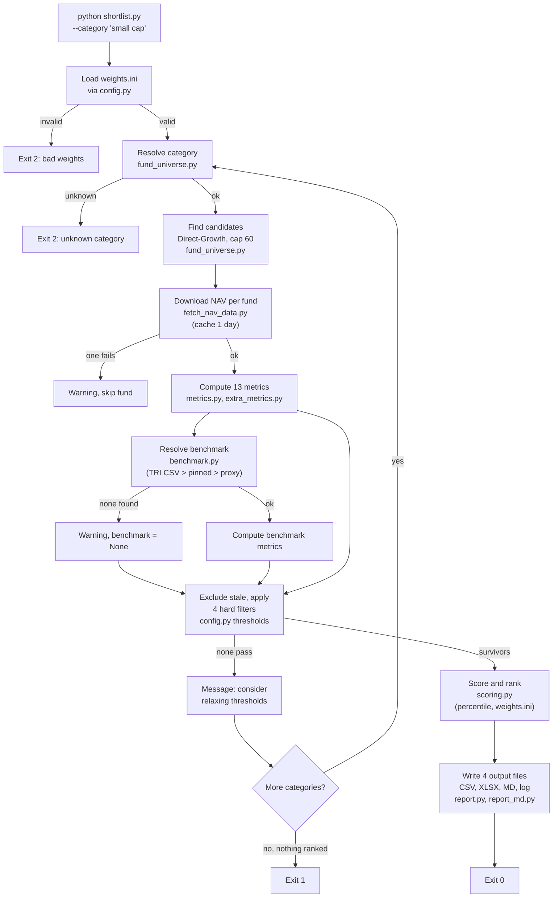
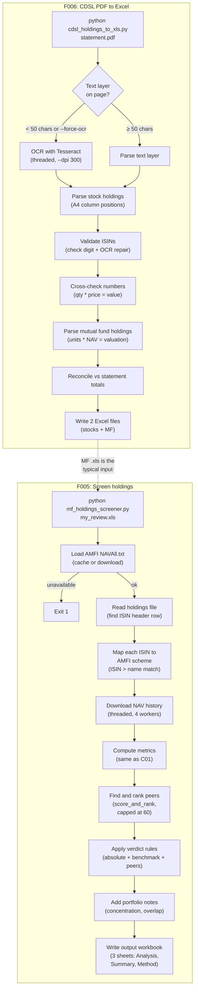
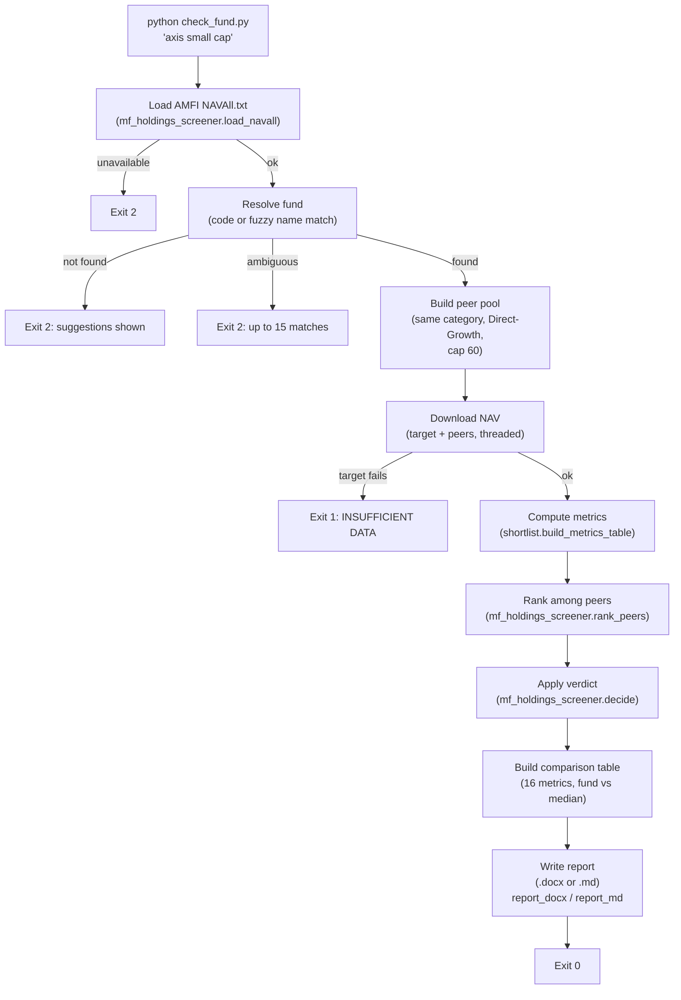

# Job flows: trigger to output

Audience: anyone who needs to understand what each script does step by step, what decisions it makes, what it writes, and where it stops on an error.
Evidence: 15 of 15 entry points read · 8 capabilities · 15 flows · 14 open unknowns relevant to this document · commit ef2fb5a · Surveyor 2.2.0 · 2026-10-24

This document covers every capability from the command line to the output files. High-importance capabilities (C01, C02, C03) include a flow diagram. Business rules list the thresholds the code uses; these are the shipped defaults and can be changed in `config.py` or `weights.ini`.

---

## C01 Shortlist and rank funds in a category (High)

Entry point: `shortlist.py` (E001). One flow: F001.

### Main flow

The owner runs `python shortlist.py --category "small cap"` (or repeats `--category` for several, or passes `--all-categories`, or gives a CSV file with a `scheme_code` column) [S01/F001].

1. **Load weights.** `config.py` reads `weights.ini` at import time. If the file is missing, malformed, or its weights do not sum to 100 (tolerance 0.01), the run stops with exit code 2 before any network call [S03/F001].
2. **Resolve the category.** The typed words (for example "small cap") are matched to one of 12 canonical categories through `fund_universe.CATEGORY_ALIASES` [S01/F001].
3. **Find candidates.** The scheme master is downloaded from mfapi.in (cached for 7 days in `data/_scheme_master.json`). Candidates are Direct-Growth schemes whose names contain the category's keywords. Index funds, ETFs and fund-of-funds are dropped. If more than 60 candidates match, they are capped alphabetically [S01/F001].
4. **Download NAV history.** Each candidate's daily NAV is fetched from mfapi.in and cached as `data/<code>.csv` for 1 day. A fund whose download fails is skipped with a warning [S01/F001, S02/F001].
5. **Compute metrics.** For each fund, 13 metrics are computed from NAV history: 1/3/5-year CAGR, volatility, Sharpe-style ratio, Sortino ratio, rolling 3-year positive percentage, SIP XIRR, max drawdown (3-year window), benchmark excess return, rolling beat percentage, portfolio quality, downside capture, quartile consistency, Jensen's alpha and beta. A metric returns None when the fund's history is too short [S02/F001].
6. **Resolve benchmark.** `BenchmarkProvider` tries, in order: a local TRI CSV in `data/benchmarks/`, a pinned scheme code (none is pinned in the shipped config), or the Direct-Growth index fund with the longest history among the best matches. If no benchmark loads, benchmark metrics stay None and the scorer treats them as missing [S02/F001, S11/F009].
7. **Apply hard filters.** Stale funds (NAV older than 10 days) are excluded. Then four filters run: 3-year CAGR at least 10%, 5-year CAGR at least 10%, volatility at most 35%, history at least 5 years. A fund with a missing metric value also fails that filter [S01/F001].
8. **Score and rank.** Each surviving metric is turned into a 0-100 percentile score. The composite score is the weighted average over the metrics the fund has. A fund whose measured weight is below 70% of the total is listed as INSUFFICIENT_DATA. Ranks run 1 to n; ties break by scheme code. Fewer than 8 ranked funds gives LOW CONFIDENCE [S03/F001].
9. **Write output.** Four files go to the output folder: `shortlisted_funds.csv` (82 columns), `shortlisted_funds.xlsx` (with colour scale), `ranked_funds.md` (method, weights, ranking table, per-fund breakdown with strengths and risks) and `run_log.txt` (every decision and exclusion). With more than one category, a fifth file `shortlisted_exploratory.csv` pools and re-ranks all survivors [S04/F001, S14/F001].

### Alternative flows

- **CSV input.** When the query ends in `.csv`, scheme codes are read from the file instead of searching by category name [S01/F001].
- **Several categories or all categories.** Repeating `--category` or using `--all-categories` processes each category separately, then writes an exploratory cross-category ranking [S01/F001].
- **`--fetch-holdings`.** Triggers `holdings_fetch.fetch_all` to download portfolio files before scoring. The alternative path was not fully traced; it calls the same holdings fetch as C05 [S01/F001].
- **`--rolling-years`.** Overrides `config.ROLLING_WINDOW_YEARS` at run time by mutating the module attribute [S01/F001].
- **`--top-n`.** Changes the number of funds shown in the Markdown detail section (default 15 in the table, detail for the top 5) [S04/F001].
- **`--weights`.** Loads a different weights file instead of the default `weights.ini` [S03/F001].
- **`--as-of-date`.** Sets the reference date for metrics, so the same data can be scored as of a past date [S01/F001].

### Exception flows

| Condition | What happens | Exit code | Evidence |
|---|---|---|---|
| Bad or missing `weights.ini` | Stops before any network call with a `WeightsError` message | 2 | [S03/F001] |
| Unknown category | Stops with an error message | 2 | [S01/F001] |
| No category given | Stops with an error message | 2 | [S01/F001] |
| Missing CSV file | Stops with an error message | 2 | [S01/F001] |
| Bad `--rolling-years` or `--as-of-date` | Stops with an error message | 2 | [S01/F001] |
| One fund's NAV download fails | Warning printed; that fund is skipped; the run continues | 0 | [S01/F001] |
| Benchmark cannot load | Warning printed; benchmark metrics are None; scoring continues | 0 | [S02/F001] |
| No fund passes the hard filters | Message naming the category; the run continues to the next category | 0 (per category) | [S01/F001] |
| Nothing ranked across all categories | Exit 1 | 1 | [S01/F001] |
| Missing `openpyxl` | Excel export prints a message and returns False; the run continues | 0 | [S04/F001] |

### Business rules

| Rule | Threshold | Source |
|---|---|---|
| Direct and Growth plans only | `REQUIRE_DIRECT_PLAN = True`, `REQUIRE_GROWTH_PLAN = True` | `config.py:25-26` [S01/F001] |
| Index funds, ETFs and fund-of-funds excluded | `INCLUDE_INDEX_FUNDS = False` | `config.py:27` [S01/F001] |
| Candidate cap per category | 60 (alphabetical) | `config.py:29` [S01/F001] |
| Scheme master cache | 7 days | `config.py:24` [S01/F001] |
| NAV cache | 1 day | `config.py:19` [S02/F001] |
| Stale NAV exclusion | 10 days | `config.py:71` [S01/F001] |
| Minimum 3-year CAGR | 10% | `config.py:44` [S01/F001] |
| Minimum 5-year CAGR | 10% | `config.py:45` [S01/F001] |
| Maximum volatility | 35% | `config.py:46` [S01/F001] |
| Minimum history | 5 years | `config.py:48` [S01/F001] |
| 1-year CAGR filter | Off (None) | `config.py:40` [S01/F001] |
| Risk-return ratio filter | Off (None) | `config.py:42` [S01/F001] |
| Scoring method | percentile | `weights.ini:27` [S03/F001] |
| Missing-data policy | renormalize_available | `weights.ini:22` [S03/F001] |
| Coverage floor | 70% | `weights.ini:23` [S03/F001] |
| Low-confidence threshold | 8 ranked funds | `weights.ini:30` [S03/F001] |
| Risk-free rate | 6.5% annualised | `config.py:34` [S02/F001] |
| Drawdown window | 3 years | `config.py:94` [S02/F001] |
| Ratio window aligned | True (volatility measured over the same window as the return) | `config.py` [S02/F001] |
| Rolling windows needed | 12 | `metrics.py:171` [S02/F001] |
| Benchmark staleness tolerance | 10 days | `benchmark.py:200` [S02/F001] |
| Benchmark proxy candidates | 6 (lowest scheme codes) | `config.py` [S02/F001] |
| Expense ratio | Not scored (by design) | `weights.ini` [S03/F001] |

### Flow diagram

All nodes correspond to files and functions traced in S01 through S04 and S14. The benchmark resolution path (dashed intent: TRI CSV, pinned, proxy) is detailed in S02 and S11.

---

## C02 Screen funds you already hold (High)

Two flows: F005 (holdings screener) and F006 (CDSL PDF conversion).

### F005 Screen holdings and say keep or review

Entry point: `mf_holdings_screener.py` (E005).

#### Main flow

The owner runs `python mf_holdings_screener.py my_review.xls` with a holdings spreadsheet (typically the MF output of `cdsl_holdings_to_xls.py`) [S05/F005].

1. **Load AMFI's NAVAll.txt.** From `--navall`, a local cache (1 day), or download from two AMFI URLs. Falls back to an older cache if the download fails. Stops if nothing works [S05/F005].
2. **Read the holdings file.** Finds the header row (the first row with an "ISIN" cell), requires "Scheme Name" and "ISIN" columns. Stops if the header is missing [S05/F005].
3. **Map each holding to an AMFI scheme.** First by ISIN. If the ISIN is not in AMFI's file, a name-match fallback compares against Direct-Growth schemes; it needs 90% similarity and a 2-point lead over the runner-up. Unmatched holdings get INSUFFICIENT DATA [S05/F005].
4. **Download NAV history** for each held scheme (mfapi.in, threaded with `--workers` 4 by default). A failed download gives that fund INSUFFICIENT DATA [S05/F005].
5. **Check for quick verdicts.** A Rs 0 valuation gives REVIEW ("appears wound up or closed"). A NAV older than 10 days gives REVIEW [S05/F005].
6. **Compute metrics** for each held fund using the same metric functions as C01 [S05/F005].
7. **Find and rank peers.** Unless `--no-peers`: for each held fund's AMFI category (only categories in `PEER_CATEGORY_KEYWORDS`), open-ended Direct-Growth schemes are collected, capped at 60 including the held fund. Peers are scored using `shortlist.score_and_rank` with `weights.ini` weights, no hard filters [S05/F005].
8. **Apply the verdict rules.** Three evidence types (absolute, benchmark, peers), each with red and amber levels. REVIEW when 2 or more reds, or 1 red and 2 ambers, or stale NAV. CONTINUE when no reds and fewer than 2 ambers. Otherwise WATCH [S05/F005].
9. **Add portfolio notes.** Single fund above 15% of the portfolio, 3 or more funds in one category, Regular-plan ISINs, IDCW options. These do not change the verdict [S05/F005].
10. **Write the output workbook.** Three sheets: Holdings Analysis (every input column plus 33 new ones), Summary (counts by verdict, value by category), Method (every rule and threshold). Default name: input name with `-Screened` before the extension. `.xls` via `xlwt`, `.xlsx` via `openpyxl` [S05/F005].

#### Alternative flows

- **`--no-peers`.** Skips peer ranking; verdicts use absolute and benchmark evidence only. Confidence drops to Low or Medium [S05/F005].
- **`.xlsx` output.** When the output name ends in `.xlsx`, `openpyxl` is used instead of `xlwt` [S05/F005].
- **`--navall`.** Uses a saved AMFI file instead of downloading [S05/F005].
- **Name-match fallback.** When an ISIN is not in AMFI's file, the name match is tried. A successful match is flagged "verify" in the output [S05/F005].

#### Exception flows

| Condition | What happens | Exit | Evidence |
|---|---|---|---|
| No header row with "ISIN" | Stops with a message | 1 | [S05/F005] |
| Missing required columns | Stops with a message | 1 | [S05/F005] |
| NAVAll.txt unavailable (download and cache both fail) | Stops with instructions | 1 | [S05/F005] |
| NAVAll.txt has no scheme rows | Stops with a message | 1 | [S05/F005] |
| One fund's NAV download fails | That fund gets INSUFFICIENT DATA; the run continues | 0 | [S05/F005] |
| Unmapped ISIN | That fund gets INSUFFICIENT DATA | 0 | [S05/F005] |
| Less than 3 years of history | INSUFFICIENT DATA (unless stale, which is REVIEW) | 0 | [S05/F005] |

#### Business rules

| Rule | Threshold | Source |
|---|---|---|
| Name-match minimum similarity | 90% | `mf_holdings_screener.py:92` [S05/F005] |
| Name-match lead over runner-up | 2 points | `mf_holdings_screener.py:93` [S05/F005] |
| Stale NAV days | 10 | `mf_holdings_screener.py:64` [S05/F005] |
| Minimum history for a verdict | 3 years | `mf_holdings_screener.py:65` [S05/F005] |
| Absolute red: 3-year CAGR below risk-free rate (6.5%) | red | `mf_holdings_screener.py:418` [S05/F005] |
| Absolute amber: 5-year CAGR below risk-free rate | amber | `mf_holdings_screener.py` [S05/F005] |
| Benchmark red: 3-year excess return at or below -2% per year | red | `mf_holdings_screener.py:72` [S05/F005] |
| Benchmark amber: 3-year excess return below 0 | amber | `mf_holdings_screener.py` [S05/F005] |
| Rolling beat red: below 30% of windows | red | `mf_holdings_screener.py` [S05/F005] |
| Rolling beat amber: below 45% | amber | `mf_holdings_screener.py` [S05/F005] |
| Rolling beat green: at least 60% | green | `mf_holdings_screener.py` [S05/F005] |
| Peer red: percentile at or below 25 | red | `mf_holdings_screener.py` [S05/F005] |
| Peer amber: percentile below 50 | amber | `mf_holdings_screener.py` [S05/F005] |
| Drawdown worse than peer median by 10+ points | amber | `mf_holdings_screener.py:76` [S05/F005] |
| Minimum peer group size | 8 | `mf_holdings_screener.py` [S05/F005] |
| REVIEW verdict | stale NAV, or red in 2+ types, or red in 1 and amber in 2 | `mf_holdings_screener.py:479` [S05/F005] |
| WATCH verdict | red in 1 type, or amber in 2 | `mf_holdings_screener.py` [S05/F005] |
| Single-fund concentration warning | above 15% of portfolio | `mf_holdings_screener.py:613` [S05/F005] |
| Category overlap warning | 3 or more funds in one category | `mf_holdings_screener.py` [S05/F005] |
| Peer cap | 60 (same as shortlist) | `mf_holdings_screener.py:549` [S05/F005] |

### F006 Convert a CDSL statement PDF to holdings spreadsheets

Entry point: `cdsl_holdings_to_xls.py` (E006).

#### Main flow

The owner runs `python cdsl_holdings_to_xls.py statement.pdf` with a CDSL Consolidated Account Statement PDF [S06/F006].

1. **Open the PDF.** If a password is needed, `--password` supplies it (CDSL uses PAN in capitals) [S06/F006].
2. **Detect the text layer.** Pages with fewer than 50 characters are treated as image-only. When no text is found, or `--force-ocr` is set, the page is rendered at `--dpi` (default 300) and OCR'd with Tesseract in a thread pool of `--workers` (default 4) [S06/F006].
3. **Parse stock holdings.** The "HOLDING STATEMENT" tables are parsed using hardcoded A4 column x-positions (reference width 595.22 points). Each row is anchored by an ISIN in the ISIN column with numbers on the same line. Names are multi-line blocks assigned by vertical proximity [S06/F006].
4. **Validate ISINs.** Every ISIN is checked by its Luhn-based check digit. For OCR, each ISIN is read at several magnifications and segmentation modes. Common OCR look-alikes (O/0, I/1, S/5, B/8) are substituted only when the check digit then passes. Ambiguous or invalid ISINs are flagged [S06/F006].
5. **Cross-check numbers.** For stocks: qty times price must equal value (tolerance 0.02). For mutual funds: units times NAV equals valuation, valuation minus invested equals profit/loss, profit/loss divided by invested equals the percentage. Rows that fail are flagged in a "Check" column [S06/F006].
6. **Parse mutual fund holdings.** The "MUTUAL FUND UNITS HELD AS ON" section is parsed. Three cross-checks per row. A "Grand Total" row ends the section [S06/F006].
7. **Reconcile.** Stock totals per demat account are compared with the "Portfolio Value" printed in the statement. Mutual fund totals are compared with the "Grand Total" row [S06/F006].
8. **Write two Excel files.** `<name>_holdings.xls` (stocks, with a Reconciliation sheet) and `<name>-MF.XLS` (mutual funds, with a Reconciliation sheet). Rows that fail a cross-check are highlighted yellow [S06/F006].

#### Alternative flows

- **`--force-ocr`.** Bypasses the text-layer check and OCR's every page [S06/F006].
- **`--skip-mf`.** Writes only the stock holdings file [S06/F006].
- **`--pages`.** Restricts scanning to a page range [S06/F006].
- **`.xlsx` output.** When the output name ends in `.xlsx`, `openpyxl` is used instead of `xlwt` [S06/F006].
- **`--password`.** Opens an encrypted PDF [S06/F006].

#### Exception flows

| Condition | What happens | Exit | Evidence |
|---|---|---|---|
| No holding rows found | Stops with a message suggesting `--force-ocr` or higher `--dpi` | 1 | [S06/F006] |
| Page needs OCR but Tesseract is not installed | Stops with an installation message | 1 | [S06/F006] |
| Output format library missing (`xlwt` or `openpyxl`) | Stops with an installation message | 1 | [S06/F006] |
| Cross-check failure on a row | Row is written with a yellow "Check" flag; the run continues | 0 | [S06/F006] |
| No mutual fund rows | Message printed; stocks are already written; the run continues | 0 | [S06/F006] |

#### Business rules

| Rule | Threshold | Source |
|---|---|---|
| A4 reference width | 595.22 points | `cdsl_holdings_to_xls.py:69` [S06/F006] |
| Text-layer threshold | 50 characters per page | `cdsl_holdings_to_xls.py:592` [S06/F006] |
| Stock cross-check tolerance | qty * price = value within 0.02 | `cdsl_holdings_to_xls.py:464` [S06/F006] |
| MF valuation tolerance | units * NAV = value within max(1.0, 0.0005 * value) | `cdsl_holdings_to_xls.py:793` [S06/F006] |
| ISIN check-digit algorithm | Luhn on the ISIN digits | `cdsl_holdings_to_xls.py:159` [S06/F006] |
| Early stop for stocks | 2 consecutive pages with no rows | `cdsl_holdings_to_xls.py:614` [S06/F006] |

### Flow diagram (C02)

The dashed arrow from F006 to F005 is inferred: `mf_holdings_screener.py:7` states the input is "the mutual fund holdings .xls produced by cdsl_holdings_to_xls.py" [S05/F005]. The remaining nodes map to functions traced in S05 and S06.

---

## C03 Check one fund (High)

Entry point: `check_fund.py` (E003). One flow: F003.

### Main flow

The owner runs `python check_fund.py axis small cap` (fund name words) or `python check_fund.py 125354` (AMFI scheme code) [S07/F003].

1. **Load AMFI's NAVAll.txt** through `mf_holdings_screener.load_navall` [S07/F003].
2. **Look up the fund.** If the query is all digits, look up by scheme code. Otherwise, tokenise the name (dropping "direct", "plan", "growth", "fund"), match all tokens against every Direct-Growth scheme. If multiple schemes match: prefer exact-token matches, then drop stale twins (NAV older than 30 days from the newest), then drop schemes with 2 ISINs (IDCW mislabelled Growth). If still ambiguous, show up to 15 matches with codes. If nothing matches, show fuzzy suggestions above 50% similarity [S07/F003].
3. **Build the peer pool.** All open-ended Direct-Growth schemes in the same normalised AMFI category with a current NAV, capped at 60 alphabetically. The target fund is always included. Stale peers are dropped with a note [S07/F003].
4. **Download NAV history** for the target and peers (threaded, default 4 workers) [S07/F003].
5. **Compute metrics and rank.** `shortlist.build_metrics_table` computes all metrics for the pool. `shortlist.apply_hard_filters` checks whether the target passes the shortlist criteria. `mf_holdings_screener.rank_peers` ranks the target among peers. `mf_holdings_screener.decide` produces the screen verdict (same rules as F005) [S07/F003].
6. **Build a comparison table.** 16 metrics, each showing the fund's value, peer median, "better than x% of peers" (direction-aware), and the weight from `weights.ini` [S07/F003].
7. **Write the report.** Markdown to stdout: fund identity, screen result (red flags, cautions, positives), metrics table, benchmark used, shortlist filter result, top 5 of the category, disclaimers. Also written to a file: `.docx` by default (via `report_docx.markdown_to_docx`), or `.md` with `--format md`. File path: `<output-dir>/fund_check_<code>.<format>` [S07/F003, S04/F003].

### Alternative flows

- **`--no-peers`.** Skips category comparison; downloads only the target fund's history [S07/F003].
- **`--format md`.** Writes Markdown instead of Word [S07/F003].
- **`--no-file`.** Prints to stdout only [S07/F003].
- **`--rolling-years`.** Overrides the rolling window [S07/F003].
- **`--refresh`.** Re-downloads NAV even if cached [S07/F003].
- **`--weights`.** Uses a different weights file [S07/F003].

### Exception flows

| Condition | What happens | Exit | Evidence |
|---|---|---|---|
| Bad command line, bad weights file | Error message | 2 | [S07/F003] |
| Fund not found or ambiguous | `FundLookupError` with suggestions | 2 | [S07/F003] |
| AMFI file unavailable | Error (from `load_navall`) | 2 | [S07/F003] |
| Target fund's NAV fetch fails | INSUFFICIENT DATA verdict | 1 | [S07/F003] |
| Missing `python-docx` | Warning printed; no file written (not an error exit) | 0 | [S07/F003, S04/F003] |
| Peer NAV download fails | That peer is left out; the run continues | 0 | [S07/F003] |

### Business rules

| Rule | Threshold | Source |
|---|---|---|
| Stale-twin threshold | 30 days | `check_fund.py:65` [S07/F003] |
| Peer pool cap | 60 | `config.MAX_FUNDS_TO_SCAN` [S07/F003] |
| Fuzzy-name suggestion minimum | 50% similarity | `check_fund.py` [S07/F003] |
| Metrics shown | 16 (the 13 from C01 minus portfolio quality but with all new metrics displayed) | `check_fund.py:69` [S07/F003] |
| Verdict rules | Same as F005 | [S07/F003, S05/F005] |
| Default output format | `.docx` | `check_fund.py:469` [S07/F003] |

### Flow diagram

All nodes map to functions traced in S07 and S04.

---

## C04 Rank funds from a supplied metrics file (Medium)

Entry point: `rank_funds.py` (E002). One flow: F002.

### Main flow

The owner runs `python rank_funds.py --input metrics.csv` with a CSV of pre-computed metrics (no internet needed) [S08/F002].

1. **Load weights** from `weights.ini` (or `--weights`) [S08/F002].
2. **Read and validate the CSV.** Two column styles are accepted: "spec style" (percent numbers) and "toolkit style" (fractions). The style is auto-detected from column names or forced with `--units`. Mixed styles with `benchmark_excess_return` are rejected (ambiguous unit). Blank, NA and out-of-range values are flagged INVALID and treated as missing [S08/F002].
3. **Filter.** Rows without a fund name are rejected. Unless `--include-all-plans`, non-Direct-Growth rows (by `plan_type`/`option` columns) are dropped. Identical duplicate rows are dropped; same name with different data is kept and flagged `DUPLICATE_NAME`. Stale funds and rows after `--as-of-date` are excluded [S08/F002].
4. **Rank per category.** Funds are grouped by `fund_category` and ranked using `scoring.score_and_rank` (same engine as C01). LOW CONFIDENCE for small groups; INSUFFICIENT_DATA for funds below the coverage floor. `expense_ratio` is present but not scored [S08/F002].
5. **Write output.** Three files: `ranked_funds.csv`, `ranked_funds.md`, `run_log.txt`. Optional `ranked_funds_exploratory.csv` with `--exploratory` [S08/F002].

### Alternative flows

- **`--units spec` or `--units toolkit`.** Forces the column style instead of auto-detection [S08/F002].
- **`--include-all-plans`.** Keeps Regular and IDCW plans [S08/F002].
- **`--ignore-category`.** Ranks all funds together regardless of category [S08/F002].
- **`--exploratory`.** Pools all categories and re-ranks (labelled EXPLORATORY) [S08/F002].
- **`--category "mid cap"`.** Ranks only the named category [S08/F002].

### Exception flows

| Condition | What happens | Exit | Evidence |
|---|---|---|---|
| File not found, empty, no fund name column, both fund_name and scheme_name, duplicate header, no metric columns, mixed-style ambiguity, no Direct-Growth rows, none of the weighted metrics present | `InputError` | 2 | [S08/F002] |
| Bad weights file | `WeightsError` | 2 | [S08/F002] |
| Nothing ranked | Exit 1 (only `run_log.txt` written) | 1 | [S08/F002] |

### Business rules

| Rule | Threshold | Source |
|---|---|---|
| Range for `cagr_3y` | -1.0 to 10.0 | `rank_funds.py:93` [S08/F002] |
| Range for `max_drawdown` | -1.0 to 0.0 | `rank_funds.py:93` [S08/F002] |
| Range for `portfolio_quality` | 0 to 100 | `rank_funds.py:93` [S08/F002] |
| Missing tokens | blank, na, n/a, nan, none, null, -, --, nil | `rank_funds.py:99` [S08/F002] |
| `expense_ratio` | Not scored (by design) | `rank_funds.py:90` [S08/F002] |

---

## C05 Collect fund portfolio files and score portfolio quality (Medium)

Four flows: F007 (download), F008 (sort and check), F010 (market-cap list), F015 (scoring).

### F007 Download newest portfolio files from fund houses

Entry point: `holdings_fetch.py` (E007).

The owner runs `python holdings_fetch.py` (all automated AMCs) or `python holdings_fetch.py dsp nippon_india` (named AMCs). `--list` shows every AMC's mode and page URL [S09/F007].

Three AMCs (Nippon India, DSP, Baroda BNP Paribas) have "auto" mode: the script fetches their page, selects file links by picker regexes, picks the newest by date extracted from the file name, validates the download (minimum 2048 bytes, OLE2/PK magic bytes), and saves to `data/holdings/<amc_key>/`. The remaining 29 AMCs print a manual checklist with URLs. A failed page load or download prints a message and continues to the next AMC [S09/F007].

### F008 Sort and check downloaded portfolio files

Entry point: `holdings_import.py` (E008).

The owner runs `python holdings_import.py ~/Downloads/*.xls*` or `python holdings_import.py --check`. Files are matched to an AMC by longest-alias-wins matching against `amc_registry.AMCS` aliases (first 12 rows of each sheet). Unrecognised files go to `data/holdings/unsorted/`. Files are copied (not moved). After import, `PortfolioIndex` parses all workbooks and prints a score summary [S09/F008].

### F010 Build the AMFI large/mid/small company list

Entry point: `build_marketcap.py` (E010).

The owner runs `python build_marketcap.py AMFI_list.xlsx` with AMFI's half-yearly categorisation list (Excel, CSV or PDF). The script detects ISIN and Large/Mid/Small Cap columns by content, deduplicates, validates (warnings for suspicious counts), and writes `data/amfi_market_cap.csv` [S09/F010].

### F015 Portfolio-quality scoring

Entry point: `portfolio_quality.py` (E015, also a library).

As a library, `shortlist.py` calls `PortfolioIndex.lookup` per scheme. As a CLI, `python portfolio_quality.py data/holdings` prints every parsed sheet's score. The score is a 0-100 weighted average of five sub-criteria: top-10 concentration, number of equity holdings, top sector percentage, large+mid-cap percentage (from `amfi_market_cap.csv`), and cash percentage. Each sub-criterion is mapped linearly between configurable worst and best thresholds. A sheet needs at least 10 equity holdings. The score is None when data is insufficient, the statement is stale, or the scheme name cannot be matched [S10/F015].

### Exception flows (all C05 flows)

| Flow | Condition | What happens | Evidence |
|---|---|---|---|
| F007 | Page load or download fails for one AMC | Message, continues to next AMC | [S09/F007] |
| F008 | Unreadable file or bad zip | Skipped with a message | [S09/F008] |
| F008 | Nothing imported | Exit 1 | [S09/F008] |
| F010 | Input unreadable or unsupported type | Exit 2 | [S09/F010] |
| F010 | No ISIN + category rows found | Exit 1 | [S09/F010] |
| F015 | Few holdings, bad weight sum, stale, unmatched, low coverage | Returns None with a reason string; never crashes | [S10/F015] |

### Business rules (portfolio quality)

| Rule | Threshold | Source |
|---|---|---|
| Equity ISIN pattern | `INE____01___` | `portfolio_quality.py:51` [S10/F015] |
| Minimum equity holdings | 10 (from `config.PQ_MIN_EQUITY_HOLDINGS`) | `portfolio_quality.py:199` [S10/F015] |
| Weight sum tolerance | Configurable around 100% (`config.PQ_SUM_TOLERANCE`) | `portfolio_quality.py:172` [S10/F015] |
| Fraction-to-percent auto-detection | Sum of weights 0.9-1.1 means fractions | `portfolio_quality.py:172` [S10/F015] |
| Staleness | `config.PQ_MAX_AGE_DAYS` | `portfolio_quality.py:364` [S10/F015] |
| Name-match threshold | `config.PQ_NAME_MATCH_RATIO` (fuzzy) | `portfolio_quality.py:317` [S10/F015] |
| Download validation (F007) | Minimum 2048 bytes, OLE2 or PK magic bytes | `holdings_fetch.py:99` [S09/F007] |
| AMC auto-fetch count | 3 of 32 | `amc_registry.py` [S09/F007] |

---

## C06 Provide benchmark index history (Medium)

Entry point: `import_tri.py` (E009). One flow: F009.

### Main flow

The owner runs `python import_tri.py --category "small cap" nifty_smallcap_tri.csv` with one or more TRI (Total Return Index) CSV files downloaded from NSE [S11/F009].

1. **Read each CSV.** Auto-detect the date column and the value column (by name: "close", "tri", "total return", "value", "nav", "index") [S11/F009].
2. **Merge and clean.** Duplicate dates are dropped (last wins), the series is sorted by date [S11/F009].
3. **Validate.** At least 250 usable rows required (exit 1 otherwise). Warnings for gaps over 10 days, staleness, or fewer than 5 years of history [S11/F009].
4. **Write.** `data/benchmarks/<category>.csv` (date and nav columns). This file is what `BenchmarkProvider._load` looks for first, replacing the index-fund proxy [S11/F009].

### Alternative flows

- **`--list`.** Prints all 11 categories and their expected index names [S11/F009].
- **Multiple CSV files.** Merged into one series before validation [S11/F009].

### Exception flows

| Condition | What happens | Exit | Evidence |
|---|---|---|---|
| Missing `--category` or no input files | Error message | 2 | [S11/F009] |
| Unknown category | Error message | 2 | [S11/F009] |
| Unreadable input | Error message | 2 | [S11/F009] |
| Fewer than 250 rows | Error message | 1 | [S11/F009] |
| Gaps, staleness, short history | Warning (non-fatal) | 0 | [S11/F009] |

### Business rules

| Rule | Threshold | Source |
|---|---|---|
| Minimum rows | 250 | `import_tri.py:82` [S11/F009] |
| Gap warning | 10 days | `import_tri.py:95` [S11/F009] |
| Short-history warning | 5 years | `import_tri.py:103` [S11/F009] |
| Categories defined | 11 (small cap through dividend yield; sectoral absent) | `config.BENCHMARKS` [S11/F009] |
| Filename convention | spaces to underscores, " & " to " and " | `import_tri.py:28` [S11/F009] |

---

## C07 Back-test the forward signals (Medium)

Entry point: `backtest.py` (E004). One flow: F004.

### Main flow (as designed; cannot run at commit ef2fb5a)

The owner would run `python backtest.py "mid cap"` to test whether each forward signal predicted future returns [S12/F004].

1. **Find funds.** Same candidate lookup as C01 for the given category [S12/F004].
2. **Download NAV history.** For all eligible funds [S12/F004].
3. **Build an as-of grid.** Past dates spaced by `--step-months` (default 6), each truncating fund histories to that date (no look-ahead) [S12/F004].
4. **Compute forward signals at each date.** Five NAV-derived signals (sharpe stability, rolling p10/dispersion, beta drift, down-capture drift) and four CSV-based signals (expense ratio, AUM strain, manager tenure, turnover) [S12/F004].
5. **Measure realised returns.** The fund's actual return over the next `--horizon` years [S12/F004].
6. **Compute Spearman rank correlation** between each signal's goodness and the realised return at each date [S12/F004].
7. **Verdict.** "Supported" when mean IC >= threshold and positive share >= threshold. "Inverted" when reliably negative. "Insufficient data" when too few dates [S12/F004].
8. **Write output.** Summary CSV, detail CSV, and printed table with suggested zero-weight for unsupported signals [S12/F004].

### Known issue

`backtest.py` calls `benchmark.resolve_benchmark`, which does not exist in `benchmark.py` at this commit. `config.py` defines none of the `BACKTEST_*`, `FORWARD_*` or `MANIFEST_JSON` settings these modules reference. `test_forward_signals.py` imports helpers from `test_pipeline.py` that do not exist. The modules appear to belong to a feature branch that has not been merged [S12/F004, U26].

### Exception flows (as designed)

| Condition | What happens | Evidence |
|---|---|---|
| No query given | Early exit | [S12/F004] |
| No candidates found | Early exit | [S12/F004] |
| Too few eligible funds | Early exit (below `config.BACKTEST_MIN_FUNDS`) | [S12/F004] |
| No usable as-of dates | Warning and exit | [S12/F004] |

---

## C08 Set up, refresh data and diagnose (Low)

Four flows: F011, F012, F013, F014.

### F011 Download and cache NAV history

Entry point: `fetch_nav_data.py` (E011).

Standalone: `python fetch_nav_data.py 120503 118989`. Also called as a library by every other entry point that needs NAV. Downloads each scheme's history from mfapi.in, caches as `data/<code>.csv` for 1 day, saves a `_meta.csv` with scheme name, fund house and category. In standalone mode, sleeps 0.3 seconds between requests. Per-fund failures are caught and warned [S13/F011].

### F012 First-run check against the live services

Entry point: `live_check.py` (E012).

`python live_check.py` (optionally with `--holdings` and `--category`). Runs six guarded steps: (1) download scheme master (5,000+ schemes expected), (2) look up a category and find candidates, (3) download one fund's NAV and check recency, (4) resolve benchmarks for all 11 categories, (5) download and parse NAVAll.txt, (6) optionally run `holdings_fetch.fetch_all()`. Each step reports PASS, WARN or FAIL independently. Exit 0 if no step failed, 1 otherwise [S13/F012].

### F013 Patch the Word report format

Entry point: `apply_docx_patch.py` (E013).

`python apply_docx_patch.py` (run once in the folder with `check_fund.py`). A one-time migration script that patches `check_fund.py` to default to `.docx` output, updates the test, adds `python-docx` to `requirements.txt`, and updates `README.md`. Creates `.bak` backups. Safe to re-run: skips already-patched text [S13/F013].

### F014 Diagnose AMFI NAVAll parsing

Entry point: `navall_diag.py` (E014).

`python navall_diag.py [path-to-NAVAll.txt]`. A debugging aid that prints the raw lines, matched category headers, and parsed scheme counts from `NAVAll.txt` using `mf_holdings_screener.parse_navall`. Helps the owner understand why parsing found zero Direct-Growth schemes. Read-only; changes nothing [S13/F014].

---

## Unknowns and next probes

| ID | Question | Capability | Next probe |
|---|---|---|---|
| U10 | Are the hard-filter defaults the owner's intended settings? | C01 | Ask the product owner |
| U13 | Does the test suite pass? At least 5 assertions expect values `weights.ini` no longer has. | C01 | Run the tests or ask a developer |
| U14 | Are the shipped weights the intended current weights, including alpha and beta at 5 each? | C01 | Ask the product owner |
| U17 | Is `config.py` an older copy than the back-test modules? `manifest.py` has no caller. | C01, C07 | Ask a developer or check `git log` |
| U18 | What happens when AMFI blocks the NAVAll.txt download? Nothing tests the download path. | C02 | Ask the owner about past failures |
| U19 | Do tracked spreadsheets hold real folio numbers, and is the repo pushed to a remote? | C02 | Ask the product owner |
| U20 | Do the hardcoded A4 column positions work for all CDSL statement versions? | C02 | Test with several real PDFs |
| U21 | Why are there no tests for a 1,174-line CDSL script? | C02 | Ask the developer |
| U22 | Does `test_check_fund.py` pass? It stubs benchmark and portfolio-quality paths. | C03 | Run the tests |
| U23 | Do the three AMC picker regexes still match today's websites? | C05 | Run `holdings_fetch.py` against one AMC |
| U24 | How consistent are industry names across AMC workbooks? | C05 | Run `portfolio_quality.py` on real holdings |
| U25 | Does `import_tri.py` handle all NSE download formats? | C06 | Test with a real NSE CSV |
| U26 | Are the missing config settings and functions in an unmerged branch? `backtest.py` cannot run. | C07 | Ask the developer or check `git log --all` |
| U27 | Is the 0.3s API sleep sufficient, and does the cache handle concurrent runs? | C08 | Ask the owner about rate-limit errors |

## Related documents

- [01-overview.md](01-overview.md): what the project does, capabilities table, system context diagram
- [02-module-architecture.md](02-module-architecture.md): module layout, dependency diagram, patterns
- 04 (core feature): will cover the scoring engine in depth
- [05-api-reference.md](05-api-reference.md): every entry point's parameters, inputs and outputs
- [09-test-exposure-map.md](09-test-exposure-map.md): test results per capability and flow
