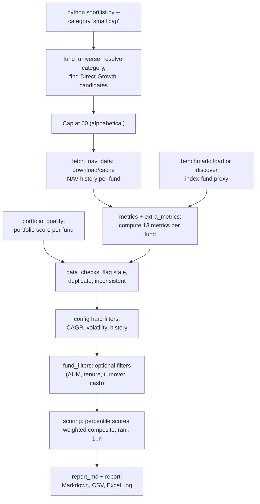
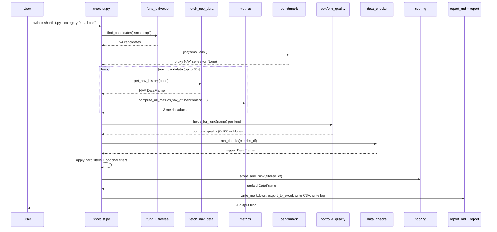

# Shortlist and rank funds in a category

Audience: anyone who needs to understand how the project's core capability works end to end, from a typed category name to a ranked shortlist with scored explanations, to maintain, extend or audit the scoring pipeline.
Evidence: 15 of 15 entry points read · 8 capabilities · 9 open unknowns relevant to this document · commit ef2fb5a · Surveyor 2.2.0 · 2026-10-24

C01, "Shortlist and rank funds in a category", is the capability the whole project exists for. Every other capability either feeds it (C05 portfolio quality, C06 benchmarks, C07 signal back-testing), reuses its engine (C02 holdings screener, C03 single-fund check, C04 CSV ranking), or supports it (C08 setup and diagnostics) [capabilities.md].

This document traces the pipeline from the command line to the output files, section by section: candidate lookup, metric calculation, scoring, filtering, reporting, and the risks that follow from the design.

## Pipeline overview

Every node maps to evidence in S01 through S04 and S10. The benchmark and portfolio-quality steps run in parallel with the per-fund metric loop inside `shortlist.py` [S01/F001, S02/F001].

## Interfaces

### Entry point

`shortlist.py` (470 lines) is the only entry point. It accepts [S01/F001]:

| Argument | Purpose |
|---|---|
| `--category` (repeatable) | One or more fund categories to rank |
| `--all-categories` | Rank all 12 categories and produce an exploratory cross-category list |
| first positional argument ending in `.csv` | A CSV with a `scheme_code` column; ranks those funds instead of looking them up |
| `--output-dir` | Where to write results (default: current folder) |
| `--rolling-years` | Override `config.ROLLING_WINDOW_YEARS` for rolling-return windows |
| `--as-of-date` | Pretend today is this date (for back-dated runs) |
| `--weights` | Path to an alternative `weights.ini` |
| `--top-n` | How many funds to show in the ranking table |
| `--fetch-holdings` | Download portfolio files before scoring (triggers C05) |
| `--refresh` | Force a fresh download of NAV history and scheme master |

`shortlist.py:300` - `ap.add_argument("--category", action="append", default=[], help="a category to rank (repeat for several)")` (checked) [S01]

### Internal interfaces

The pipeline is a chain of function calls inside `shortlist.main`. There is no message bus, queue or event system [inventory].

| Step | Module | Function called | Input | Output |
|---|---|---|---|---|
| Candidate lookup | `fund_universe` | `find_candidates(category)` | Category string | List of `{scheme_code, scheme_name_hint}` dicts |
| NAV download | `fetch_nav_data` | `get_nav_history(code)` | Scheme code | DataFrame with `date` and `nav` columns |
| Metric computation | `metrics` | `compute_all_metrics(nav_df, ...)` | NAV DataFrame, benchmark, config | Dict of 13 metric values (or None) |
| Benchmark resolution | `benchmark` | `BenchmarkProvider.get(category)` | Category string | Benchmark NAV series, or None |
| Portfolio quality | `portfolio_quality` | `PortfolioIndex.fields_for_fund(name)` | Scheme name | Dict with `portfolio_quality` (0-100 or None) plus sub-scores |
| Data checks | `data_checks` | `run_checks(df)` | Metrics DataFrame | Same DataFrame with `data_flags` column |
| Hard filters | `shortlist` | inline in `prepare_group` | Metrics DataFrame | Filtered DataFrame, excluded-fund list |
| Optional filters | `fund_filters` | `apply_optional_filters(df)` | Metrics DataFrame | Same DataFrame with warning flags |
| Scoring | `scoring` | `score_and_rank(df)` | Filtered DataFrame | DataFrame with rank, status, confidence, scores, contributions |
| Reporting | `report_md` | `write_markdown(...)` | Ranked DataFrame, config, log | `ranked_funds.md` written |
| Excel export | `report` | `export_to_excel(df, path)` | Ranked DataFrame | `shortlisted_funds.xlsx` written |

Sources: `shortlist.py:119` (`compute_all_metrics`), `shortlist.py:419` (`score_and_rank`), `shortlist.py:454` (`write_markdown`), all checked [S01, S02, S03, S04].

### Output files

A completed run writes four files to the output folder [S01/F001, S04/F001, S14/F001]:

| File | Format | Contents |
|---|---|---|
| `shortlisted_funds.csv` | CSV, 82 columns | One row per candidate: raw metrics, benchmark metrics, portfolio quality, data flags, per-metric scores and contributions, composite and final scores, rank, status, confidence |
| `shortlisted_funds.xlsx` | Excel | Same data, with bold header, frozen first row, percent formatting and a three-colour scale on the final score |
| `ranked_funds.md` | Markdown (UTF-8) | Method, weights table, ranking table (top 15), excluded funds with reasons, per-fund breakdown (top 5) with strengths, weak spots, gaps and risk notes, exploratory table if applicable, disclaimer |
| `run_log.txt` | Plain text | Timestamped record of every step: category, candidates found, benchmark used, stale exclusions, filter exclusions, final counts |

With more than one ranked category, a fifth file `shortlisted_exploratory.csv` is written: a cross-category ranking with the label "exploratory" [S01/F001].

## Implementations

### Candidate lookup (`fund_universe.py`)

`fund_universe.find_candidates` resolves a typed string (e.g. "small cap") to one of 12 canonical categories through `CATEGORY_ALIASES` (lines 33-48), then matches funds by keywords in the scheme name using `CATEGORY_KEYWORDS` (lines 52-65). Only Direct plans with the Growth option are kept; IDCW, dividend, bonus, index, ETF and fund-of-funds are excluded. The scheme master is fetched from `https://api.mfapi.in/mf` and cached in `data/_scheme_master.json` for 7 days [S01/F001].

When the candidate count exceeds `MAX_FUNDS_TO_SCAN` (60), the list is sorted alphabetically and capped. This means the 60 funds selected are those whose names come first alphabetically, not the best or most relevant ones [S01/F001].

### Metric computation (`metrics.py`, `extra_metrics.py`, `benchmark.py`)

Each metric returns None when history is too short, so a fund is scored on what it has. The 13 scored metrics, their rules and their data requirements [S02/F001]:

| Metric | Rule | Minimum data needed |
|---|---|---|
| `cagr_1y` | Simple return over 1 year | NAV on or before the start date (30-day tolerance) |
| `cagr_3y` | CAGR over 3 years | Same tolerance |
| `cagr_5y` | CAGR over 5 years | Same tolerance |
| `volatility` | Standard deviation of monthly returns times the square root of 12 | 6 monthly returns |
| `risk_return_ratio` | (CAGR minus 6.5% risk-free rate) divided by volatility. The return leg is the 3-year CAGR (else 5-year, else 1-year). By default, volatility is measured over the same 3-year trailing period (`RATIO_ALIGN_WINDOW = True`) | Same as CAGR and volatility |
| `sortino` | Same numerator, but divided by downside deviation (using only negative monthly returns) | Same |
| `rolling_positive_pct` | Share of trailing 3-year CAGR windows that are positive, measured at every month-end | 12 rolling windows |
| `sip_xirr` | Internal rate of return of a simulated monthly SIP of 1000 over 3 years, solved by Newton-Raphson with a bisection fallback | 6 SIP instalments |
| `max_drawdown` | Largest peak-to-trough decline over the trailing 3-year window (`DRAWDOWN_WINDOW_YEARS = 3.0`). Stored as a negative number. The whole-history figure is kept as `max_drawdown_all` but not scored. | 3 years of history |
| `benchmark_excess_return` | Fund 3-year CAGR minus benchmark 3-year CAGR over matching dates. None if the benchmark's last date is more than 10 days older than the fund's. | Benchmark series and 3 years overlap |
| `rolling_beat_benchmark_pct` | Share of matched 3-year rolling windows in which the fund's CAGR exceeded the benchmark's | 12 common windows |
| `portfolio_quality` | Weighted average of 5 sub-criteria from disclosed AMC holdings (see below) | 10 equity holdings and 70% of sub-criteria measurable |
| `downside_capture` | Mean fund return divided by mean benchmark return in months when the benchmark fell. Lower is better. | 6 down months |
| `quartile_consistency` | Share of month-ends on which the fund was in the top half of the run's funds | 8 peers on a date, 12 usable dates |
| `jensen_alpha` | Alpha from a regression of monthly excess returns on benchmark excess returns, annualised | 24 common months |
| `beta` | Slope of that same regression. Lower is better. | 24 common months |

That is 15 metrics in the table. The weights file names 15 metrics, of which `downside_capture` and `quartile_consistency` ship with weight 0, so 13 carry weight in the default configuration [S03/F001].

### Benchmark resolution (`benchmark.py`)

`BenchmarkProvider` resolves a benchmark for a category in priority order [S02/F001, S11/F009]:

1. A local CSV in `data/benchmarks/<category>.csv` (imported via `import_tri.py`)
2. A pinned scheme code in `config.BENCHMARKS` (none is pinned in the shipped config: every entry has `"scheme_code": None`)
3. An auto-discovered index fund: the Direct-Growth fund that tracks the category's benchmark index and has the longest history among the 6 matches with the lowest scheme codes

If no benchmark is found, a warning asks the owner to drop a TRI CSV into `data/benchmarks/`. The run continues with empty benchmark metrics [S02/F001].

The auto-discovery assumes lower scheme codes are older funds. 11 categories are defined in `config.BENCHMARKS` [S11/F009].

### Portfolio quality (`portfolio_quality.py`)

Portfolio quality is a 0-100 score built from AMC-disclosed holdings (SEBI-mandated monthly portfolio statements). It has five sub-criteria, each mapped to 0-100 by a linear function between configurable "worst" and "best" values [S10/F015]:

| Sub-criterion | Measures | Better direction |
|---|---|---|
| `top10_pct` | % of NAV in the 10 largest equity holdings | Lower (less concentrated) |
| `n_holdings` | Number of equity holdings | Higher (more diversified) |
| `top_sector_pct` | % of NAV in the largest industry | Lower |
| `largemid_pct` | % of equity in large+mid caps (from the AMFI market-cap list) | Higher |
| `cash_pct` | Cash, TREPS and net receivables as % of NAV | Lower |

The final score is the weighted average of the sub-criteria that could be measured. Below the coverage floor (`PQ_MIN_COVERAGE`), the score is None. Fewer than 10 equity holdings also gives None [S10/F015].

Scheme matching uses normalised name comparison with a fuzzy-match fallback. The newest statement wins. Ambiguous matches return None [S10/F015].

In the sample small-cap run, portfolio quality scored 0 of 54 funds because no holdings files were present, contributing 5% unmeasured weight for every ranked fund [S14/F001].

### Scoring engine (`scoring.py`, `weights_loader.py`)

`scoring.score_and_rank` turns the metrics table into a ranked shortlist [S03/F001]:

1. Each metric is converted to a 0-100 percentile score: `(average rank - 1) / (n - 1) * 100`. A single fund gets 50. `downside_capture` and `beta` are sign-flipped (lower is better). Under the `zscore` method, the composite uses z-scores instead.
2. Each fund's final score is the weighted average of its available metric scores, using the weights from `weights.ini`.
3. A fund whose measured weight is below the coverage floor (70%) receives the status `INSUFFICIENT_DATA` and is not ranked.
4. Ranked funds get ranks 1 to n. Ties on score break by scheme code for stability.
5. When fewer than `min_group_size` (8) funds are ranked, the confidence is `LOW`.

The weights file (`weights.ini`) must pass strict validation [S03/F001]:
- Both `[meta]` and `[weights_percent]` sections present
- A known policy (`renormalize_available` or `average`) and method (`percentile` or `zscore`)
- Every metric named (the two optional ones, `jensen_alpha` and `beta`, can be 0)
- No unknown metric name, no negative or non-numeric weight
- Weights sum to exactly 100 (tolerance 0.01)

The shipped weights give: 1-year CAGR 5, 3-year CAGR 10, 5-year CAGR 15, Sharpe-style ratio 5, Sortino 5, rolling positive 10, SIP XIRR 5, max drawdown 10, benchmark excess 10, rolling beat 10, portfolio quality 5, downside capture 0, quartile consistency 0, Jensen's alpha 5, beta 5. Total: 100 [S03/F001].

Expense ratio is deliberately not a metric [I3, S03/F001].

### Hard filters

Applied after metrics and before scoring. Defaults in `config.py` [S01/F001]:

| Filter | Threshold | Effect |
|---|---|---|
| 3-year CAGR | at least 10% | Drops the fund |
| 5-year CAGR | at least 10% | Drops the fund |
| Volatility | at most 35% | Drops the fund |
| History | at least 5 years | Drops the fund |
| 1-year CAGR | off (`None`) | Disabled because it removed almost every established fund after a weak market year [I5] |
| Risk-return ratio | off (`None`) | Disabled for the same reason [I5] |

A fund with a missing value for a hard filter is also dropped [S01/F001].

In the sample small-cap run, 17 stale funds and 23 hard-filter failures were excluded from 54 candidates, leaving 14 ranked [S14/F001].

### Data checks (`data_checks.py`)

Flag problems but never repair the data [S03/F001]:

| Flag | Condition |
|---|---|
| `DUPLICATE_CODE` | Same scheme code appears twice |
| `DUPLICATE_NAME` | Same scheme name appears twice |
| `STALE_NAV` | NAV date older than 10 days relative to the newest in the group |
| `INCONSISTENT` | 5-year CAGR reported with under 4.9 years of history, or 3-year CAGR with under 2.9 years |
| `CATEGORY_MISMATCH` | Scheme category differs from the group's most common |
| `NO_NAV_DATE` | No date in the NAV data |
| Impossible values | CAGR or volatility outside plausible range |

### Report generation (`report_md.py`, `report.py`)

The Markdown report has a fixed structure [S04/F001]:

1. Title and disclaimer ("This is a screening tool, not investment advice" [I1])
2. Method section: scoring method, missing-data policy, coverage floor, low-confidence rule, risk-free rate, rolling window, benchmark used, data sources
3. Weights table: metric, weight %, direction
4. Per category: ranking table (top 15), not-ranked funds, excluded funds with reasons
5. Per top fund (top 5): metric value, 0-100 score, weight %, effective weight %, points, and a rule-based narrative of strengths, weak spots, gaps and risk notes
6. Exploratory cross-category table (when applicable)
7. Notes on missing data

Risk notes appear when [S04/F001]:
- Max drawdown is -35% or worse
- Beta is 1.2 or more
- The category text contains "small cap", "sectoral" or "thematic"

The per-fund explanation is rule-based text. No language model is used [I4].

If `openpyxl` is not installed, the Excel export is skipped with a message and the run continues [S04/F001].

## Rules

### Configuration as shared mutable state

All settings live in `config.py` as module-level constants. `weights_loader.apply_weights` is called at import time (`config.py:182`), which means the weights are loaded once when any module first imports `config`. `shortlist.py` also mutates `config.ROLLING_WINDOW_YEARS` at runtime when `--rolling-years` is given (`shortlist.py:322`). This means settings are shared mutable module state: any import of `config` in the same process sees the mutated value [S01/F001, S03/F001].

### Missing data policy

The shipped policy `renormalize_available` means a fund is scored on whatever metrics it has. If a fund is missing 3 of the 13 weighted metrics, its score is the weighted average of the other 10, rescaled so the available weights sum to 100%. The alternative policy `average` would give a missing metric the average score (50 out of 100) [S03/F001].

The coverage floor (70%) prevents a fund from being ranked when too few metrics are available. A fund below the floor is listed as `INSUFFICIENT_DATA` [S03/F001].

### Duplicate rolling-return implementation

`metrics.calculate_rolling_returns` and `benchmark._rolling_cagr` implement the same rule (trailing CAGR at every month-end). The benchmark module's docstring says "same rule as metrics.calculate_rolling_returns". The two copies could drift apart [S02/F001].

`shortlist.py` calls `benchmark._rolling_cagr` and `benchmark._month_end_nav` for the quartile-consistency metric (`shortlist.py:144`), reaching into private names (leading underscore) [S02/F001].

## Risks

### The 60-fund alphabetical cap

When a category has more than 60 candidates, `shortlist.py` sorts alphabetically and takes the first 60. Funds whose names start with later letters are excluded regardless of quality. In the small-cap sample, 54 candidates meant the cap did not apply; for a category with more funds it would [S01/F001].

### Weights file and test suite contradiction

At least five test assertions in `test_scoring.py`, `test_new_metrics.py` and `test_pipeline.py` expect values the current `weights.ini` no longer has: 11 weighted metrics instead of 13, `cagr_3y` at 15 instead of 10, method `zscore` instead of `percentile`, and Jensen's alpha and beta at weight 0 instead of 5. The `test_pipeline.py` bad-weights test replaces text that is not in the current file, so it would get a valid file and pass without testing the error path [S03/F001, U13].

Whether the test suite passes today is unknown: Surveyor does not run code [U13].

### Comments contradict the shipped weights

`weights.ini` lines 45-50 say Jensen's alpha and beta are "off by default", while lines 51-52 give each 5 points. The version number in `weights.ini` is still 2, although the comments on line 10 say to bump it when weights change [S03/F001, U14].

### No assertion on core return calculations

The CAGR (1, 3, 5-year), volatility and SIP XIRR calculations in `metrics.py` have no known-answer assertion in the test files that S02 read. The drawdown window, aligned ratio, alpha, beta, benchmark metrics, downside capture and quartile consistency are well tested. Whether another test file covers the gap is unknown [S02/F001, U11].

### Benchmark auto-discovery depends on scheme-code ordering

The proxy search picks the Direct-Growth index fund with the longest history among the 6 matches with the lowest scheme codes. The assumption that lower codes are older funds is not documented or verified outside the code [S02/F001].

### Portfolio quality often missing

In the sample run, no fund had portfolio quality scored (0 of 54). This means 5% of the total weight was unmeasured for every ranked fund. The `renormalize_available` policy rescales around the gap, so the remaining 95% decides the ranking. If portfolio files are supplied, this metric becomes active and can shift ranks [S10/F015, S14/F001].

### backtest.py and forward_signals.py cannot run

`backtest.py` references `benchmark.resolve_benchmark` (does not exist) and multiple `config.BACKTEST_*` and `config.FORWARD_*` settings that `config.py` does not define. `manifest.py` has no caller. `test_forward_signals.py` references `config.MANIFEST_JSON` (also missing). These modules appear to be from a different version than `config.py` [S04/F001, S12, U17, U26].

This does not block the C01 shortlisting pipeline, which does not use `backtest.py` or `forward_signals.py`. It means the `--forward` option and the back-test capability (C07) are unavailable [U26].

## Failure and recovery

| Condition | Behaviour | Exit code | Source |
|---|---|---|---|
| Bad weights file (missing, invalid, wrong sum) | Stops before any network call | 2 | S01, S03 |
| Bad `--rolling-years`, `--as-of-date`, missing CSV, unrecognised category, no category given | Stops with an error message | 2 | S01 |
| Nothing could be ranked after filtering | Stops after filtering | 1 | S01 |
| A single fund's NAV download fails | Skipped with a warning; the run continues | 0 | S01 |
| Benchmark not found | Warning; benchmark metrics stay empty; the run continues | 0 | S02 |
| Portfolio quality missing for a fund | Metric is None; the fund is scored on what it has | 0 | S10 |
| `openpyxl` not installed | Excel export skipped; CSV, Markdown and log still written | 0 | S04 |
| Output file write fails (locked file, missing folder after `os.makedirs`) | Unhandled; the process crashes after ranking is done | non-zero | S04 (inferred) |

No retry or recovery mechanism exists. A failed run is re-run from the start [S01/F001].

## Sequence diagram: one category from start to finish

Every step in this diagram maps to checked evidence in S01 through S04. The loop is sequential: one fund at a time, one request per NAV download [S01/F001].

## Unknowns and next probes

| ID | Question | Next probe |
|---|---|---|
| U10 | Are the hard-filter defaults (3y/5y CAGR 10%, volatility 35%, 5 years history) the owner's intended settings? | Ask the product owner |
| U11 | Is there a test that checks `calculate_cagr`, `calculate_volatility` or `calculate_sip_xirr` against a known answer? | Search all `test_*.py` for those function names |
| U12 | Which index fund is the benchmark proxy today for each of the 11 categories, and do TRI files exist in `data/benchmarks/`? | Read `out_smallcap/run_log.txt` benchmark line (done in S14) and list `data/benchmarks/` |
| U13 | Does the test suite pass today? At least five assertions expect values `weights.ini` no longer has. | Ask a developer to run the tests, or ask whether `weights.ini` was changed on purpose after the tests were written |
| U14 | Are the shipped weights the owner's intended current weights, including 5 points each on Jensen's alpha and beta? | Ask the product owner |
| U15 | Does any test exercise the real `report.export_to_excel` or `report_md.explain`? | Search all `test_*.py` for `export_to_excel` and `explain` |
| U17 | Is `manifest.py` used by anything, and is `config.py` an older copy than the back-test code? | Ask a developer or compare with `git log -p config.py` |
| U24 | How consistent are the industry names across AMC workbooks? | Run `portfolio_quality.py data/holdings` on real holdings and inspect industry values |
| U26 | Are the missing imports and config settings in `backtest.py` / `forward_signals.py` in an unmerged branch, or were they removed? | Ask a developer |

The unknowns about the hard-filter defaults (U10) and the shipped weights (U14) affect the ranking directly. The test-suite contradiction (U13) affects confidence in the scoring engine.

## Related documents

- [01-overview.md](01-overview.md): system context and capabilities table
- [02-module-architecture.md](02-module-architecture.md): module layout, dependency diagram, patterns
- [03-request-to-response-flow.md](03-request-to-response-flow.md): all 15 flows including C01's main, alternative and exception flows
- 05-api-reference.md (not yet written): full parameter reference per entry point
- 09-test-exposure-map.md (not yet written): test results per capability and flow
